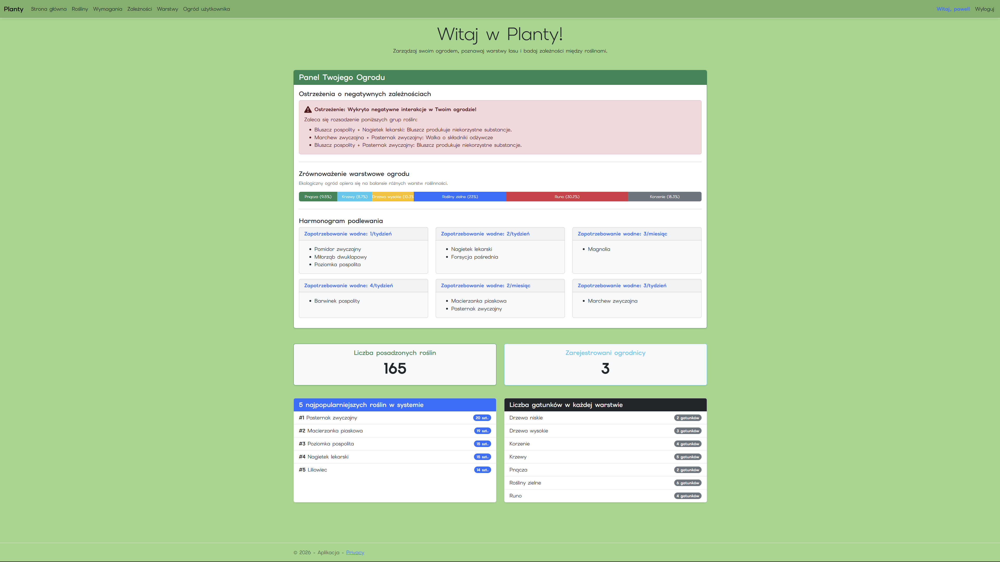
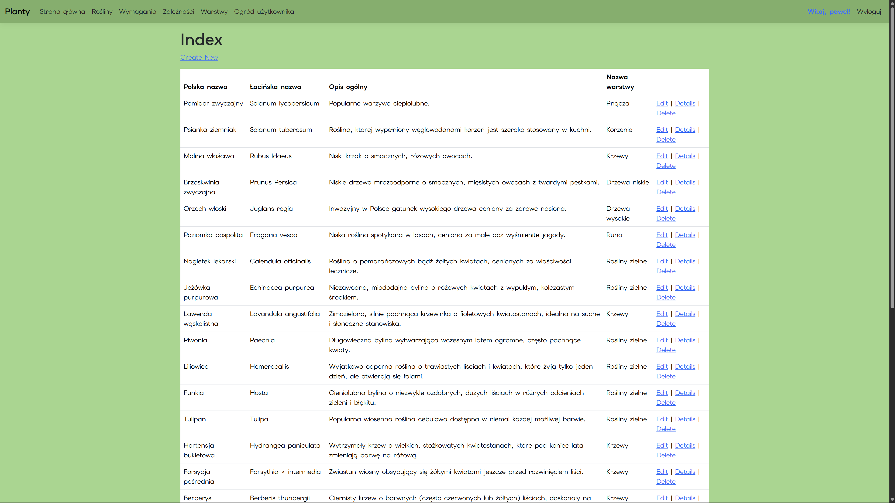
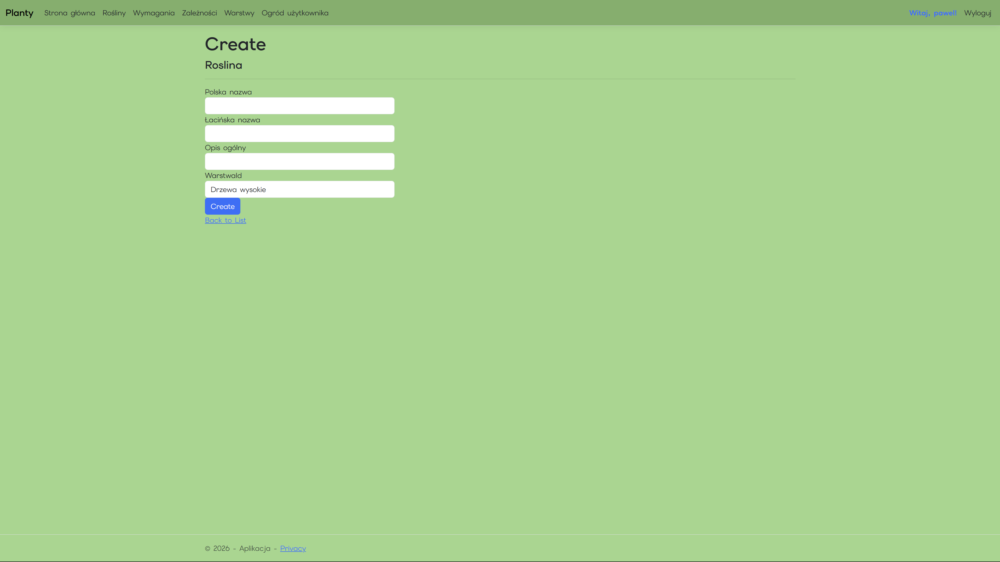
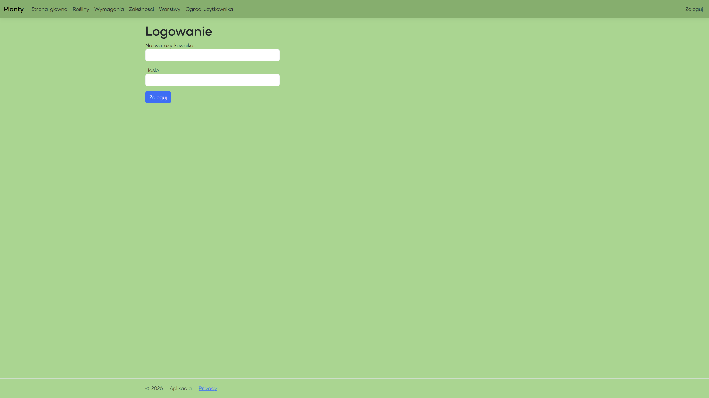

# Planty - Aplikacja do zarządzania ogrodem
## Autorzy
Paweł Czyżewski - czeski@student.agh.edu.pl 


Aleksandra Dousa - adousa@student.agh.edu.pl
## Opis
Projekt realizuje system wsparcia projektowania oraz zarządzania ogrodami permakulturowymi i ogrodami leśnymi. Głównym celem aplikacji jest dostarczenie użytkownikom narzędzia do optymalizacji nasadzeń pod kątem dwóch fundamentalnych kryteriów ekologicznych: warstwowości roślinności (piętrowego układu lasu) oraz zależności allelopatycznych (wzajemnego biochemicznego wpływu roślin na siebie).

System nie tylko działa jako klasyczna, encyklopedyczna baza danych, ale przede wszystkim implementuje dedykowaną logikę analizującą stan wirtualnego ogrodu każdego zalogowanego użytkownika. Aplikacja ułatwia planowanie zrównoważonych upraw poprzez automatyczne generowanie alertów o konfliktach sąsiedztwa i dostarczanie spersonalizowanych harmonogramów podlewania.

Aplikacja korzysta z relacyjnej bazy danych SQLite, a komunikacja z nią odbywa się w całości za pośrednictwem warstwy mapowania obiektowo-relacyjnego Entity Framework Core. System operuje na 6 powiązanych tabelach.

| Nazwa tabeli | Typ relacji i powiązania | Przeznaczenie i kluczowe pola |
|-----------------------|--------------------------|-------------------------------|
| Warstwa | Relacja 1:N z tabelą Rosliny | Definiuje piętra roślinności w ekosystemie (np. Drzewa wysokie, Krzewy, Runo, Pnącza). Pola: Id, Nazwa, Opis. |
| Roslina | Klucz obcy do Warstwy, relacje 1:1 z Wymagania, 1:N z Zaleznosci oraz Ogrody | Główna encja encyklopedyczna. Przechowuje polską i łacińską nazwę oraz ogólne parametry botaniczne. |
| Wymaganie | Relacja 1:1 z tabelą Rosliny (ścisłe powiązanie) | Specyfikacja siedliskowa danego gatunku. Pola: Naslonecznienie, RodzajGleby, ZapotrzebowanieNaWode, Mrozoodpornosc. |
| Zaleznosc | Powiązanie samoreferencyjne 1:N z Rosliny | Modeluje allelopatię. Łączy dwie rośliny i określa typ wpływu (Pozytywna/Negatywna) wraz z opisem. |
| Uzytkownik | Relacja 1:N z tabelą OgrodyUzytkownikow | Przechowuje dane kont (Nazwa, Rola w systemie, bezpieczny skrót HasloHash oraz unikalny ApiToken autoryzacyjny). |
| OgrodUzytkownika | Tabela łącząca (Klucze obce do Uzytkownicy oraz Rosliny) | Zindywidualizowany rejestr nasadzeń konkretnego ogrodnika. Przechowuje ilość sztuk, datę posadzenia oraz notatki. |

System transformuje stronę główną w inteligentny, dynamiczny panel analityczny. Po zalogowaniu system pobiera kontekst zalogowanego użytkownika i generuje trzy niezależne zestawienia:
1. Ostrzeżenia o negatywnych zależnościach: Algorytm analizuje zestaw unikalnych identyfikatorów roślin posadzonych przez danego użytkownika i krzyżowo sprawdza je z tabelą Zaleznosci dla typu "Negatywna". W przypadku wykrycia konfliktu system generuje wyraźny alert ostrzegawczy z opisem zagrożenia.
2. Statystyki warstwowości: Aplikacja agreguje sumaryczną liczbę nasadzeń użytkownika i oblicza procentowy udział poszczególnych pięter ekosystemu. Wynik prezentowany jest za pomocą skumulowanego paska postępu, dając wizualny pogląd na to, czy ogród jest poprawnie zbalansowany ekologicznie.
3. Wirtualny kalendarz pielęgnacji: Rośliny z ogrodu użytkownika są automatycznie grupowane według kryterium zapotrzebowania na wodę pobieranego bezpośrednio z tabeli Wymagania, tworząc przejrzysty, kafelkowy podział zadań dla ułatwienia organizacji nawadniania.

### ApiKlient
System integracyjny z interfejsem REST API

Aplikacja ApiKlient to autonomiczny, interaktywny program tekstowy. Służy do celów demonstracyjnych oraz testowych dla wystawionych przez główną aplikację internetową endpointów REST API.


## Graficzny interfejs

### Strona główna ze statystykami (po zalogowaniu)



### Strony z tabelami (na przykładzie encyklopedii roślin)



### Strona dodawania rekordu (na przykładzie encyklopedii roślin)



### Strona logowania




Aplikacja konsolowa komunikuje się z serwerem sieciowym bezstanowo za pomocą protokołu HTTPS przy użyciu natywnych klas .NET.


## Dokumentacja Aplikacji Konsolowej: ApiKlient

### Przeznaczenie i opis programu

Aplikacja ApiKlient to autonomiczny, interaktywny program tekstowy (CLI) napisany w języku C# (szablon .NET Console Application). Służy do celów demonstracyjnych oraz testowych dla wystawionych przez główną aplikację internetową endpointów REST API.

Program pozwala na manualne symulowanie i testowanie pełnego cyklu życia zasobów (CRUD — Create, Read, Update, Delete) w bazie danych SQLite. Działa uniwersalnie — dzięki wbudowanej parametryzacji umożliwia wykonywanie żądań HTTP do wszystkich tabel dziedzinowych systemu.

### Architektura komunikacji i bezpieczeństwo

Aplikacja konsolowa komunikuje się z serwerem sieciowym przy użyciu natywnych klas .NET (HttpWebRequest oraz HttpWebResponse).

Każde wychodzące żądanie automatycznie dołącza nagłówki uwierzytelniające (Custom HTTP Headers):

X-Username — nazwa użytkownika w systemie,

X-Api-Token — unikalny klucz przypisany do konta użytkownika.


Wszystkie dane przesyłane w operacjach zapisu (POST, PUT) oraz odczytu (GET) są w pełni serializowane do formatu JSON, przy zachowaniu izolacji struktur bazodanowych za pomocą wzorca DTO.

### Instrukcja obsługi (Menu interaktywne)

Po uruchomieniu program prezentuje panel sterowania z aktualną konfiguracją i zestawem opcji:

```Plaintext
=== INTERAKTYWNY KLIENT REST API ===
[1] Adres docelowy: https://localhost:7158/api/WarstwaApi
[2] Zalogowany jako: admin (Token: pierwszy-token-api-123)
------------------------------------
3. [GET] Pobierz wszystkie rekordy
4. [GET] Pobierz rekord po ID
5. [POST] Dodaj nowy rekord
6. [PUT] Modyfikuj rekord
7. [DELETE] Usuń rekord
0. Zakończ program
```
#### Opis funkcji:

Opcja [1] Zmiana tabeli (Endpointu): Pozwala na przełączanie się pomiędzy tabelami dziedzinowymi bazy danych. Aby zmienić kontekst operacji, wystarczy wpisać nazwę odpowiedniego kontrolera:
WarstwaApi — zarządzanie piętrami roślinności,
RoslinaApi — zarządzanie encyklopedią botaniczną,
WymaganieApi — parametry siedliskowe i zapotrzebowanie na wodę,
ZaleznoscApi — relacje allelopatyczne (sąsiedztwo roślin),
OgrodUzytkownikaApi — wirtualny rejestr nasadzeń użytkowników.

Opcja [2] Zmiana poświadczeń: Umożliwia symulację logowania na innego użytkownika lub celowe wprowadzenie błędnego tokenu w celu zademonstrowania, że serwer prawidłowo zwraca kod błędu 401 Unauthorized.

Opcja [3] GET (Wszystkie): Pobiera całą listę obiektów wybranej tabeli i wypisuje w oknie konsoli sformatowany ciąg JSON.

Opcja [4] GET (Po ID): Odpytuje serwer o konkretny, pojedynczy zasób. Jeśli obiekt nie istnieje, wyświetla komunikat 404 Not Found.

Opcja [5] POST (Dodawanie): Prosi o wprowadzenie danych obiektu jako czysty JSON. Serwer po utworzeniu rekordu zwraca kod 201 Created wraz z nadanym przez bazę, unikalnym identyfikatorem id.

Opcja [6] PUT (Modyfikacja): Służy do aktualizacji rekordu. Wymaga podania ID modyfikowanego elementu oraz przesłania nowego ciała JSON. Sukces operacji sygnalizowany jest standardowym kodem sieciowym 204 No Content.

Opcja [7] DELETE (Usuwanie): Wysyła żądanie usunięcia elementu o wybranym ID. Posiada wbudowaną obsługę błędów biznesowych serwera (np. gdy serwer zablokuje usunięcie warstwy, która zawiera przypisane rośliny, konsola czytelnie wypisze komunikat 400 Bad Request wraz ze szczegółami przekazanymi z bazy danych).
